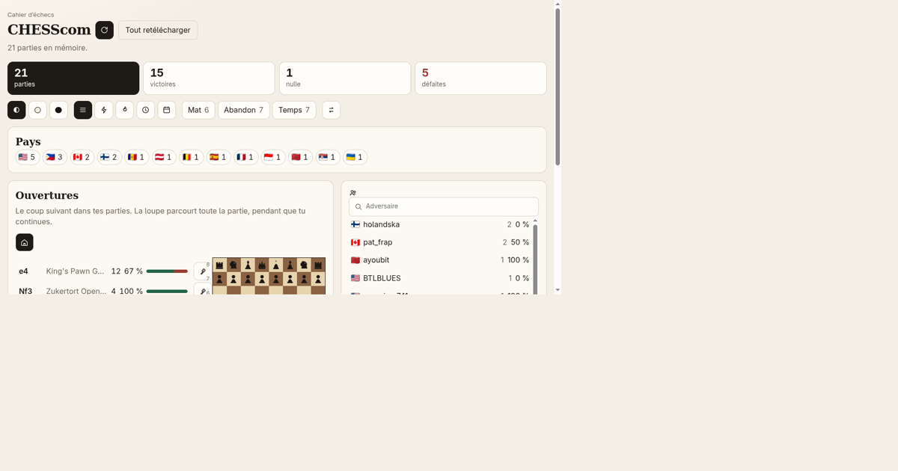

# Cahier d'échecs

**Découvre pourquoi tu perds tes parties d'échecs.** Entre ton pseudo Chess.com : l'app lit tes parties publiques, les range par ouverture et te montre, coup après coup, ce que tu joues, ce qui te réussit et où tu perds des points.

La page : https://tlloancy.github.io/cahier-echecs/



## Ce que tu obtiens

- **Ton bilan** : parties, victoires, nulles, défaites. Un clic sur l'une d'elles filtre tout le reste.
- **Où tu perds des points** : tes cinq ouvertures les moins réussies (au moins 10 parties), pour savoir quoi réviser en premier.
- **Arbre d'ouvertures** : avance coup après coup et vois, pour chaque coup, combien de fois il est arrivé et ton score.
- **Filtres** : couleur, cadence, façon de finir (mat, abandon, temps), pays et nom de l'adversaire.
- **Lignes à réviser** : épingle une ligne pour la retrouver plus tard ; export et import en fichier JSON.
- **Analyse Stockfish** : sur une ligne choisie, le moteur relit jusqu'à huit de tes parties récentes et relève tes grosses erreurs (au moins 1,5 pion de perte), côté Blancs comme côté Noirs.

## Vie privée

Tout se passe dans le navigateur. Les parties viennent de l'API publique de Chess.com et sont gardées sur l'appareil (IndexedDB). Aucun compte, aucun traceur, aucun serveur à nous. Deux services extérieurs seulement sont contactés : `api.chess.com` (les parties et le pays des adversaires) et `flagcdn.com` (les drapeaux, qui reçoivent donc l'adresse IP et les codes pays, jamais les pseudos).

Une politique de sécurité du contenu (CSP) limite la page à ces deux hôtes.

Les lignes épinglées sont la seule donnée qu'on ne peut pas retélécharger : l'app demande au navigateur de ne pas effacer ses données et propose un export. Safari peut effacer les données d'un site resté sept jours sans visite si le navigateur refuse.

## Limites à connaître

- Seules les parties de **chess standard** sont lues (pas de variantes ni de Chess960).
- Un premier chargement télécharge toutes les archives du joueur (une requête par mois, une à la fois, comme le demande Chess.com) : une à deux minutes pour quelques milliers de parties, davantage pour des comptes très actifs. Chaque mois lu est enregistré tout de suite : une coupure ou un arrêt ne fait rien perdre, et « Mettre à jour » reprend où le chargement s'était arrêté.
- L'analyse Stockfish regarde au plus **huit parties** par ligne, à profondeur 12, avec un moteur léger : c'est un repérage, pas une analyse de maître.
- Les noms d'ouvertures sont ceux du livre lichess, en anglais.

## En local

```bash
npm install
npm run dev        # serveur de développement
npm run typecheck  # types
npm test           # tests unitaires (Vitest)
npm run build      # types + build de production dans dist/
```

`npm run openings` régénère `public/openings.json` depuis [lichess-org/chess-openings](https://github.com/lichess-org/chess-openings). Le fichier déjà présent suffit pour lancer la page. Pour un résultat reproductible, fixe la révision : `OPENINGS_REF=<commit> npm run openings`. `OPENINGS_DIR` permet de lire des fichiers `a.tsv` … `e.tsv` locaux, hors ligne.

## Sources et licences

Ce dépôt est sous licence **GPL-3.0** (voir `LICENSE`). Les composants tiers (livre d'ouvertures CC0, Stockfish GPLv3, drapeaux) et l'offre de code source du moteur sont détaillés dans [`NOTICE.md`](NOTICE.md).
